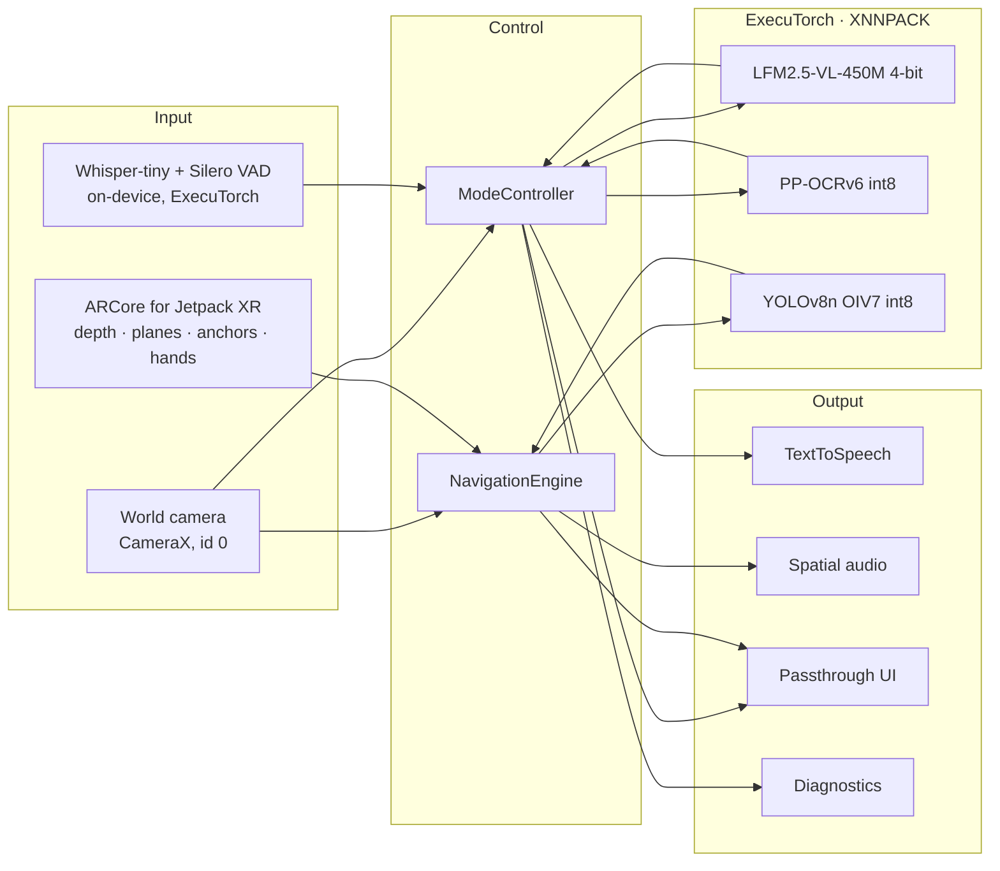

# Vysion XR

**Read a sign, understand a room, find the door. On a headset, with every model running on the headset; by default not a single frame leaves it.**

Vysion XR is a native Android XR app for the Samsung Galaxy XR with three voice-driven modes: **Text Reader**, **Audio Description** and **Navigation**. Five models run on the headset through [ExecuTorch](https://github.com/pytorch/executorch) 1.4.0 with the XNNPACK backend: a vision-language model (**LFM2.5-VL-450M**, 4-bit) that describes scenes and looks for doors, an OCR model (**PP-OCRv6**, int8) that reads text, an object detector (**YOLOv8n trained on Open Images V7**, int8) that finds people, obstacles and doors, and **Whisper-tiny** with the **Silero** voice-activity detector for voice commands. Read, Describe and Find the door need no connection. Network is used only by optional features that each have an on-device fallback (ADR-0010): an opt-in cloud Describe and the "where am I" map. A live diagnostics panel shows measured latency, memory and backend.

> **Vysion XR helps you read, understand, and move through a space. It is not validated for unassisted travel by blind users.**

Built by a team of five at the ExecuTorch Hackathon (Hacker//Squad, San Francisco, Oct 17–18 2026).

**Status: runs on the Galaxy XR.** All three modes, voice commands and the diagnostics panel run on the headset. The numbers below are measured on the device in development runs (Wi-Fi on); the formal 20-run, airplane-mode protocol has not been run yet, and anything not measured says so ([`docs/benchmarks.md`](docs/benchmarks.md)). The roadmap with gates is [`plan.md`](plan.md).

## Models on the headset

| Job | Model | Quantization | File size | Runs through |
|---|---|---|---|---|
| Describe, door check, arrival check | LFM2.5-VL-450M (Liquid AI; Software Mansion ExecuTorch export) | 8da4w (4-bit weights) | 649 MB | ExecuTorch, XNNPACK |
| Text Reader | PP-OCRv6 small (PaddleOCR; Software Mansion export) | int8 | 24 MB | ExecuTorch, XNNPACK |
| People, obstacles, doors (outlines, Find the door fast path) | YOLOv8n, Open Images V7 (601 classes), 320×320 | int8 (fp32 fallback) | 3.7 MB | ExecuTorch, XNNPACK |
| Voice commands | Whisper-tiny (OpenAI) | fp32 | 231 MB | ExecuTorch, XNNPACK |
| When someone is talking | Silero VAD 16 kHz | fp32 | 1.3 MB | ExecuTorch, XNNPACK |

Sources, hashes and licences: [`ml/models.lock`](ml/models.lock). Why these models and not the SRS's Gemma 4: [`docs/model-plan.md`](docs/model-plan.md).

## What it does

| Mode | Say | What happens | Output |
|---|---|---|---|
| Text Reader | "Vysion, read this" (or pinch-and-hold) | One world-camera frame → PP-OCR on the reading crosshair, then the whole frame (the VLM reads only when OCR is unavailable) | Spoken text in about 1.5 s (target 6 s); large-print transcript panel; "repeat", "slower", "in Spanish" |
| Audio Description | "Vysion, describe" / "what's around me" | One frame → VLM with the describe prompt (3 sentences, hazards first, left to right) | Spoken within 8 s; follow-up questions reuse the same frame |
| Navigation | "Vysion, guide me" / "find the door" | Continuous depth + planes + head pose (ARCore for Jetpack XR) + detector at about 11 fps; the detector finds the door (the VLM votes on two frames when it does not); a native anchor holds it | Spatial-audio ping from the door every 3 s, "door, 2 o'clock, 3 meters", outline in passthrough, "obstacle ahead" under 1 m, "wall ahead" |
| Where am I (optional, network) | "Vysion, where am I" | Network location + OpenFreeMap tiles; Gemini words the answer | Nearest street, cross streets and named places with meters; offline, template sentences from tiles already in memory |

Design rules (from the SRS): every visual element has an audio twin; voice first, gestures second, buttons third; clock-face bearings and meters; hazards before descriptions; "stop" interrupts anything within 300 ms; nothing is spoken that was not measured or seen.

## Demo

- Live demo script (90 s, three modes, one airplane-mode moment): [`docs/demo.md`](docs/demo.md)
- Backup video: **not recorded yet** (gate 9, Sun 12:00)
- Three-slide pitch: problem · architecture · measured results

## Architecture

Four layers in one Kotlin process. Input comes from Android XR's own camera and perception stacks and an on-device speech model; Control decides what to run; ExecuTorch models answer; Output is speech first, visuals second. The three core features have no path to the network; the optional network features (ADR-0010) are side paths with on-device fallbacks. Full diagrams, flows and the state machine: [`docs/architecture.md`](docs/architecture.md).



| Component | Runs where | Library |
|---|---|---|
| VLM LFM2.5-VL-450M (describe, door vote, arrival) | headset CPU | ExecuTorch `Module` (vision encoder + decoder runner), XNNPACK |
| OCR PP-OCRv6 (read) | headset CPU | ExecuTorch `Module`, XNNPACK |
| Detector YOLOv8n OIV7 (people, obstacles, doors) | headset CPU | ExecuTorch `Module`, XNNPACK |
| Depth, planes, anchors, hands, head pose | headset | ARCore for Jetpack XR |
| Panels, passthrough, spatial audio | headset | Jetpack Compose for XR + SceneCore |
| Speech in / out | headset | Whisper-tiny on ExecuTorch with Silero VAD (ADR-0011; Android `SpeechRecognizer` as fallback) / `TextToSpeech` |
| Network | optional features only | `INTERNET` + `ACCESS_NETWORK_STATE` (ADR-0010); every network feature has an on-device fallback, and Read, Describe and Find the door never need it; printed on the overlay. The list of record, with what each one sends, is the ADR-0010 table: opt-in cloud Describe ("cloud on"; Gemini, `GEMINI_API_KEY` in the gitignored `local.properties`, `docs/setup.md` §6b; falls back to the headset VLM), the "where am I" map (FR-N9; falls back to the tiles already in memory and template sentences) and the system recognizer when the on-device one will not bind |

## Measured numbers

Measured on the Galaxy XR (SM-I610), **development runs with Wi-Fi on**, not yet the SRS protocol (20 runs per model in airplane mode). Full tables, method and every run: [`docs/benchmarks.md`](docs/benchmarks.md). Anything without a measurement says "not measured".

| Model | Quantization | File size | Load | Time per call on the headset | Peak memory |
|---|---|---|---|---|---|
| LFM2.5-VL-450M | 8da4w | 649 MB | 3.4 s | 7.7–7.8 s for a 60-token answer (prefill 6.0 s, then 36 tokens/s); 3 runs | not measured |
| PP-OCRv6 small | int8 | 24 MB | 0.2 s | 1.15 s for a 960×720 sign; 2 runs | not measured |
| YOLOv8n OIV7 | int8 | 3.7 MB | 12 ms | 55 ms median, 70 ms p90 per `detect()` (fp32: 93 / 111 ms); 30 runs | not measured |
| Whisper-tiny + Silero VAD | fp32 | 231 MB + 1.3 MB | 2.2 s | 1.5 s median from the end of speech to the command (English, 87 synthetic clips) | not measured |

| Target (SRS §5) | Measured | |
|---|---|---|
| Command recognized → action ≤ 1.5 s | not measured | |
| Text Reader capture → first word ≤ 6 s | 1.27–1.72 s (3 worn runs) | pass in dev runs |
| Audio Description capture → first word ≤ 8 s | not measured (VLM prefill alone is 6.0 s) | |
| Detector ≥ 5 fps during Navigation | about 11 fps live | pass in 1 dev run |
| Proximity warning ≤ 300 ms | 16–114 ms from depth sample to cue (speech not included) | pass for the perception part |
| App memory with VLM loaded ≤ 4 GB | not measured | |
| 10 min Navigation without dropping below 3 fps | not measured | |
| "stop" interrupts speech ≤ 300 ms | not measured | |

## Prompts

All prompts live in [`PromptLibrary.kt`](app/src/main/kotlin/com/vysion/xr/inference/PromptLibrary.kt) and nowhere else.

- **Read:** "Read all text in this image exactly as written, top to bottom, left to right. Output only the text. If there is no text, say: No text found."
- **Describe:** "Describe this scene for someone who cannot see it, in at most three sentences. Hazards first, then what is on the left, center, and right. Do not guess."
- **Door:** "Is there a door in this image? Answer with one word: left, center, right, or none."
- **Arrival:** "Is this door open or closed, and which side is the handle on? One short sentence."

## Setup: fresh clone to running app on the headset (target ≤ 30 min)

Detailed walkthrough and troubleshooting: [`docs/setup.md`](docs/setup.md). Every version is pinned in [`gradle/libs.versions.toml`](gradle/libs.versions.toml) and explained, with its source, in [`docs/stack.md`](docs/stack.md).

1. **Prerequisites:** JDK 17, Android SDK with the platform and build-tools named in `docs/setup.md`, `platform-tools` (adb). No Android Studio required.
2. **Clone and point Gradle at the SDK:**
   ```bash
   git clone https://github.com/Cool-Coder174/vysion-app.git vysion-xr && cd vysion-xr
   echo "sdk.dir=$HOME/Library/Android/sdk" > local.properties   # Linux: $HOME/Android/Sdk
   ./gradlew assembleDebug testDebugUnitTest
   ```
3. **Models.** `ml/models.lock` lists every artifact with its sha256. `scripts/fetch_models.sh` downloads them into `app/src/main/assets/models/` (release builds); during development, sideload instead so the multi-GB models stay out of the APK: `scripts/push_models.sh` (it also pushes `models.lock`, which the app needs to resolve sideloaded files when the APK was built without `scripts/fetch_models.sh`). Export recipes: [`ml/README.md`](ml/README.md). Prebuilt `.pte` files will be attached to the release tag.
4. **Install on the headset** (developer mode + ADB over USB-C or Wi-Fi, see `docs/setup.md`):
   ```bash
   scripts/install_headset.sh --logcat            # add --wifi <ip>:<port> for ADB over Wi-Fi (port from the pairing screen)
   ```
5. **Airplane mode on.** Every benchmark and the demo run offline; `scripts/benchmark.sh` refuses otherwise.
6. **No headset?** `./gradlew installDebug -PuseFakes=true` wires the fake camera and fake inference engine so the app runs on an emulator or the Galaxy S25 Ultra (which also serves as the 2D fallback demo device).

### Pinned versions

Verified live on 2026-10-17 against Maven metadata and the reference docs; sources and verification records in [`docs/stack.md`](docs/stack.md) §1.

| Component | Version |
|---|---|
| ExecuTorch Android AAR `org.pytorch:executorch-android` (XNNPACK flavor) | **1.4.0** (the PP-OCRv6 and LFM2.5-VL exports are 1.4.x) |
| ARCore for Jetpack XR `androidx.xr.arcore:arcore` · SceneCore · XR runtime | **1.0.0-rc02** |
| Jetpack Compose for XR `androidx.xr.compose:compose` | **1.0.0-beta01** |
| CameraX | 1.6.2 |
| Compose BOM | 2026.09.00 |
| Android Gradle Plugin / Gradle / Kotlin / JDK | 9.4.1 / 9.6.1 / 2.4.21 / 17 |
| compileSdk / minSdk / targetSdk | 37 / 34 (Galaxy XR is Android 14) / 36 |
| Android SDK packages | `platforms;android-37.0`, `build-tools;36.0.0`, `platform-tools` |

## Project layout

```
app/src/main/kotlin/com/vysion/xr/
  core/         Contracts.kt — every cross-module interface and type (the SRS handoff table as code)
  platform/     R1: camera, mode state machine, overlay, panels, device profile
  inference/    R2: ExecuTorch engine, prompts, model catalog, fakes
  perception/   R3: ARCore session, proximity, anchors, navigation cues, spatial audio
  voice/        R4: speech recognition, command grammar, TTS, cues, earcons
  diagnostics/  R5: overlay, memory sampler, manifest audit, benchmark receiver (debug)
docs/           requirements, NFRs, architecture, contracts, model plan, schedule, risks, demo,
                assumptions, benchmarks, ADRs, per-role module pages, stack pins, setup
ml/             models.lock, export recipes and scripts
scripts/        fetch_models, push_models, install_headset, benchmark, check_privacy, check_cues
plan.md         roadmap and gates (engineer-workflow); executor.md: phase specs; History/: archive
```

## Working on it

- **Humans:** [`CONTRIBUTING.md`](CONTRIBUTING.md) (branches, 15-minute merge cadence, definition of done, review checklist). Roles and tasks: [`docs/modules/`](docs/modules/). Schedule and gates: [`docs/schedule.md`](docs/schedule.md).
- **Coding agents:** [`AGENTS.md`](AGENTS.md) is the operating manual (read order, repo map, hard rules, commands, where every fact lives). `CLAUDE.md` summarizes it.
- **Hard rules, enforced by CI or review:** network only with an on-device fallback (ADR-0010); camera frames never persisted or logged; every spoken string in `voice/Cues.kt`; every prompt in `inference/PromptLibrary.kt`; every displayed number measured on the device; modules talk only through `core` contracts.
- **Backlog in code:** `grep -rn "TODO(" app/src/main/kotlin` lists every stub with its FR id.

## Limitations

- An assistive aid, not a safety device. Not validated for unassisted travel by blind users.
- English and Spanish only. No accounts, no phone companion app. Cloud is optional and off by default: an opt-in cloud Describe (Gemini; sends one JPEG) and the "where am I" wording; both fall back to the headset (ADR-0010). The manifest therefore declares `INTERNET`, `ACCESS_NETWORK_STATE` and location.
- Depends on third-party camera access to the world-facing camera on the Galaxy XR (assumption A-1 in [`docs/assumptions.md`](docs/assumptions.md)); if unavailable, Read and Describe run on the S25 Ultra and Navigation stays on the headset with depth and planes only (no door finding, no detector outlines).
- Door finding uses the detector first, then a two-frame VLM vote. On Open Images test photos the detector finds about 1 door in 10 at the app's threshold (doors there are often small or partly hidden; [`docs/benchmarks.md`](docs/benchmarks.md)), so it works best with a clear door a few meters ahead. Multiple doors are a stretch goal.
- While walking, the door marker can drift slightly; "floor ends" and "keep guiding with the door out of view" are not yet tested on the device.
- **The VLM is LFM2.5-VL-450M, not the SRS's Gemma 4.** The Gemma 4 export does not load in ExecuTorch's `LlmModule` ([`docs/stack.md`](docs/stack.md) D5), and a 450M model leaves memory for the other four models; see [`docs/model-plan.md`](docs/model-plan.md). On the headset the VLM needs about 6 s before its first word (prefill), so Describe is slower than Read.
- Navigation outlines pause while the VLM answers a one-shot command (the detector is unloaded to keep peak memory to one model).

## Troubleshooting

| Symptom | Cause | Fix |
|---|---|---|
| `fetch_models.sh` exits 2 | lockfile rows still have `url: TBD` | build with `ml/export/*.sh` and run `--from <dir>`, or download the release assets |
| App says "model not found" | no `.pte` in the external files dir or assets, no lockfile on the device, or a sideloaded file failed its size/sha256 check (`adb logcat -s vysion.security`) | `scripts/push_models.sh` (dev; also pushes `models.lock`) or `scripts/fetch_models.sh` + reinstall; re-push a truncated file |
| Gradle: unsupported class file version | wrong JDK | use JDK 17 (`JAVA_HOME=/Library/Java/JavaVirtualMachines/jdk-17.jdk/Contents/Home` on the macOS hosts) |
| Jetpack XR artifact not found | `google()` repository missing or version typo | compare `gradle/libs.versions.toml` with `docs/stack.md`; run `./gradlew --refresh-dependencies` |
| No camera frames on the headset | permission not granted, or firmware does not expose camera id 0 | check logcat `vysion` for `camera 0: <w>x<h> <format> at <fps> fps (A-1 evidence)`; see A-1 fallback |
| Voice commands need Wi-Fi | the Whisper files are not sideloaded, so the system recognizer took over (`asr: Whisper files unavailable` in logcat) | `scripts/push_models.sh` (rows `asr`, `asr-preprocessor`, `asr-tokenizer`, `vad`); pinch-and-hold and panel buttons always work |
| `benchmark.sh` refuses to run | airplane mode off | `adb shell cmd connectivity airplane-mode enable` |

## Team

| Role | Owns | Name |
|---|---|---|
| R1 XR Platform | app shell, passthrough, camera, panels, overlay, mode state machine | |
| R2 ML / ExecuTorch | model exports, `.pte` files, `InferenceEngine`, prompts, measurement | |
| R3 Spatial Perception | ARCore session, depth, planes, anchors, navigation cues, spatial audio | |
| R4 Voice & Accessibility UX | speech in/out, grammar, cues, panel spec, TalkBack, user testing | |
| R5 Integration, Docs & Demo | repo, scripts, diagnostics overlay, S25 build, README, benchmarks, video, pitch | |

## License

MIT, see [`LICENSE`](LICENSE). The SRS this repository implements is in [`docs/srs/`](docs/srs/).
