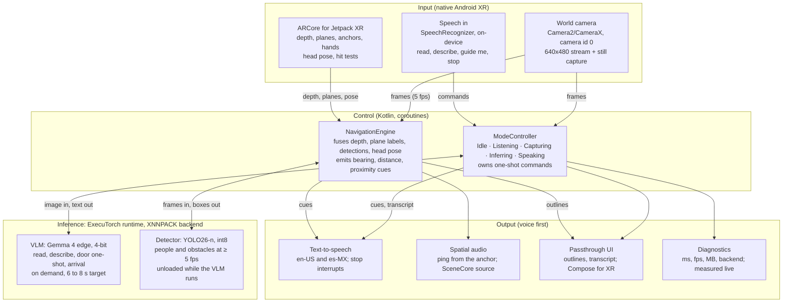
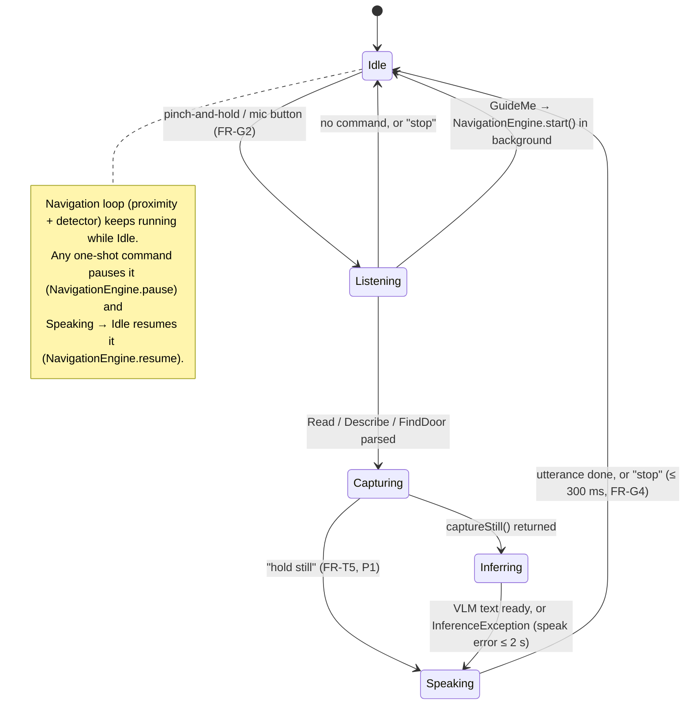

# Architecture

Source: SRS §6, plus the package map and the two flows the skeleton codes against. **Four layers in one Kotlin process: input adapters feed a mode controller, the controller calls two ExecuTorch modules, and output goes to speech, spatial audio, and passthrough overlays. No layer has a path to the network.**

## Nothing leaves the headset: four layers, two ExecuTorch models



Input comes from Android XR's own camera, perception, and speech stacks; Control decides what to run; the two ExecuTorch models answer; Output is speech first, visuals second. The only arrow that skips a layer is Control → Output, because inference results are spoken by Control, not by the models.

## Package map (one package per role, one shared contract)

| Layer | Package (`com.vysion.xr.`) | Owner | Key types | Doc |
|---|---|---|---|---|
| shared | `core` | R5 (changes announced, merged first) | `Contracts.kt` (every cross-module interface and data type), `Units.kt` (clock-face bearing, half-meter rounding) | [`contracts.md`](contracts.md) |
| Input + Control | `platform` | R1 | `FrameSource`, `ModeController`, `OverlayRenderer`, `platform.ui.*` panels, `Permissions` | [`modules/r1-xr-platform.md`](modules/r1-xr-platform.md) |
| Inference | `inference` | R2 | `InferenceEngine` (ExecuTorch impl), `PromptLibrary`, `ModelCatalog`, `FakeInferenceEngine` | [`modules/r2-ml-executorch.md`](modules/r2-ml-executorch.md) |
| Input + Control | `perception` | R3 | `XrPerceptionSession`, `ProximityMonitor`, `AnchorStore`, `NavigationEngine`, `SpatialAudioPinger`, `HeadPoseSource` | [`modules/r3-spatial-perception.md`](modules/r3-spatial-perception.md) |
| Input + Output | `voice` | R4 | `CommandBus`, `CommandGrammar`, `Speaker`, `Cues`, `Earcons` | [`modules/r4-voice-accessibility.md`](modules/r4-voice-accessibility.md) |
| Output | `diagnostics` | R5 | `DiagnosticsOverlay`, `DiagnosticsCollector`, `MemorySampler`, `ManifestAudit` | [`modules/r5-integration.md`](modules/r5-integration.md) |
| entry | (root) | R1 | `VysionApplication`, `MainActivity`, `AppGraph` (manual wiring, no DI framework) | [`modules/r1-xr-platform.md`](modules/r1-xr-platform.md) |

Rules (SRS §6, "design decisions that keep five people from colliding"):

1. One `InferenceEngine` owns both models behind a `Mutex`; the detector is unloaded while the VLM generates and reloaded after, so peak memory is one model plus the runtime.
2. Camera runs two streams: a 640x480 analysis stream for the detector and an on-demand still capture, center-cropped and resized to the VLM's input size.
3. `ModeController` is a state machine: Idle, Listening, Capturing, Inferring, Speaking, back to Idle. Navigation is a background loop that any one-shot command can interrupt and that resumes afterward.
4. Every module exposes a Kotlin `Flow` or a `suspend fun`; no module reaches into another's internals. `core/Contracts.kt` is the handoff table as code.

## ModeController state machine



Watchdog: `INFERRING` has a 15 s timeout; on expiry the controller speaks `Cues.inferenceFailed` and returns to `Idle` (NFR reliability: never silent > 10 s during a task; the "thinking" earcon repeats every 4 s while inferring).

## Flow 1: Text Reader, end to end (gate 5)

```mermaid
sequenceDiagram
  participant U as User
  participant CB as CommandBus (R4)
  participant MC as ModeController (R1)
  participant FS as FrameSource (R1)
  participant IE as InferenceEngine (R2)
  participant SP as Speaker (R4)
  participant TP as TranscriptPanel (R1)
  U->>CB: "Vysion, read this"
  CB-->>MC: Command.Read
  MC->>SP: earcon(THINKING)
  MC->>FS: captureStill()
  FS-->>MC: Bitmap (center-cropped to VLM input)
  MC->>IE: describe(bitmap, PromptLibrary.READ)
  Note over IE: Mutex: unload detector → VLM generate → reload detector
  IE-->>MC: text (first word ≤ 6 s after capture)
  MC->>TP: show(text) (48 dp+, 7:1)
  MC->>SP: say(text)
  SP-->>TP: progress (auto-scroll synced to speech)
  U->>CB: "in Spanish"
  CB-->>MC: Command.InSpanish
  MC->>IE: describe(sameBitmap, PromptLibrary.TRANSLATE_ES)
  MC->>SP: setLocale(es-MX); say(text)
```

## Flow 2: Find the door (gate 7)

```mermaid
sequenceDiagram
  participant CB as CommandBus (R4)
  participant MC as ModeController (R1)
  participant FS as FrameSource (R1)
  participant IE as InferenceEngine (R2)
  participant AS as AnchorStore (R3)
  participant NE as NavigationEngine (R3)
  participant SP as Speaker (R4)
  participant OR as OverlayRenderer (R1)
  CB-->>MC: Command.FindDoor
  MC->>NE: pause()
  MC->>FS: captureStill() ×2
  MC->>IE: describe(frame1, DOOR), describe(frame2, DOOR)
  alt both answers agree and are not "none" (RK-6)
    MC->>AS: placeFromBearing(LEFT|CENTER|RIGHT)
    AS-->>MC: AnchorId (depth sampled along the bearing)
    MC->>NE: guideTo(anchorId); resume()
    loop every 3 s while guiding (FR-N3)
      NE-->>SP: DoorBearing(clock, distanceM) → "door, 2 o'clock, 3 meters"
      NE-->>OR: highlightDoor(box)
      NE->>NE: spatial ping from the anchor
    end
    NE-->>MC: Arrived (anchor within 1 m, FR-N6)
    MC->>IE: describe(frame, ARRIVAL)
    MC->>SP: say(handle side, open/closed)
  else disagree, or "none"
    MC->>SP: say(Cues.doorNotFound) → "I can't find a door, turn slowly"
    MC->>NE: resume()
  end
```

## Threading model

| Work | Dispatcher | Why |
|---|---|---|
| Camera callbacks → `Flow<Bitmap>` | CameraX executor → `Dispatchers.Default` conversion | keep the camera thread free; drop frames with `conflate()` so the detector never queues |
| `InferenceEngine.describe/detect` | `Dispatchers.Default` limited to 1 via the `Mutex` | one model at a time; peak memory is one model + runtime |
| Depth sampling at 10 Hz, anchors, head pose | `Dispatchers.Default`, one `perception` scope | ARCore session APIs are called from the owning scope only |
| `Speaker`, `CommandBus` | `Dispatchers.Main` for Android TTS/SpeechRecognizer callbacks | both APIs are main-thread bound |
| Compose panels | Main | standard |

Every long-running loop is a `Job` owned by `AppGraph` and cancelled in `MainActivity.onStop`; nothing survives the process.

## Memory strategy

```
peak = runtime + max(VLM, detector) + camera buffers + Compose
       ≈ 0.2 GB + ~1.5–2.5 GB (Gemma 4 edge 4-bit, measured on device) + 0.05 GB + 0.1 GB
       budget 4 GB (NFR), alarm at 3.5 GB PSS (unload detector, refuse new VLM calls with Cues.busy)
```

The number that matters is the measured VLM PSS; until it exists the overlay prints "not measured".

## Privacy boundary

- No `android.permission.INTERNET` in the manifest (CI grep + runtime audit printed on the overlay).
- Camera frames live only in memory (`Bitmap` held by the active command, recycled after). There is no code path that writes a `Bitmap` to disk; `scripts/check_privacy.sh` greps for `Bitmap.compress`, `FileOutputStream`, `MediaStore` and `Log.*` of frame data.
- The only files the app writes are the copied model files under `filesDir/models/`.
- No analytics, no crash reporter, no third-party SDK with a network path.
